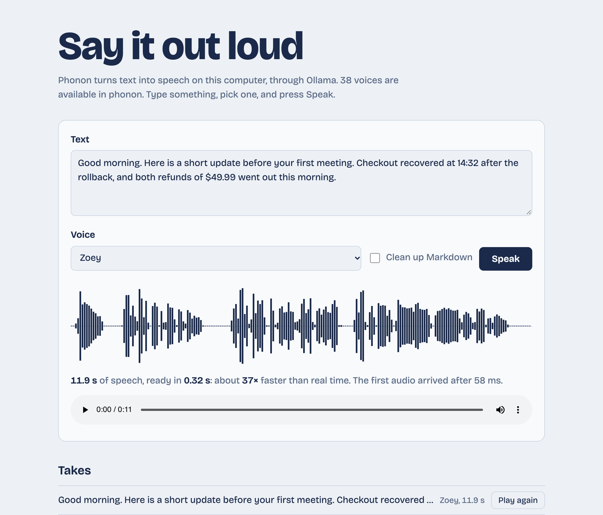

# Phonon speech demo

**Text to speech that runs on your own Mac: Gradium's [Phonon](https://ollama.com/library/phonon), served by Ollama. Its first audio arrives in about 30 ms, and it speaks 35–45× faster than real time.** This repo shows the model off five ways (from the terminal, a Markdown file read aloud, a voice gallery, a benchmark, and a local web page), in plain Python with no runtime dependencies.

[](https://github.com/gsaini/phonon-speech-demo/actions/workflows/ci.yml)


> An independent demo, not affiliated with Gradium or Ollama. Measured on 2026-10-25; the model is a week old, so re-check anything you rely on.



## The model

| | |
|---|---|
| what it does | text in, speech out: 16-bit mono WAV or raw PCM at 24 kHz, streamed while it is generated |
| default tag `phonon` | 43M parameters, 112 MB, **38 English voices**, **Apache 2.0** |
| `phonon:40m-multilingual` | 57M parameters, 148 MB, **103 voices** across English, French, German, Spanish and Portuguese, **CC BY-NC 4.0** (non-commercial) |
| runs on | Apple Silicon only, through Ollama's MLX runner; needs **Ollama 0.40.9 or later** |
| API | Ollama's OpenAI-compatible `POST /v1/audio/speech`, at most 4,096 characters per request |

The voices range from plain (Zoey, Easton, Freya, Hugh) to characters (Captain Silas Blackwater, Grub the Ogre, The Snow Queen, The Thing Under the Stairs). `phonon-demo voices` lists them. Eight are in [samples/](samples/), all reading the same sentence.

## Quick start

```bash
brew upgrade ollama                       # Phonon needs 0.40.9+; `ollama --version` to check
ollama pull phonon                        # 112 MB

git clone https://github.com/gsaini/phonon-speech-demo.git
cd phonon-speech-demo
uv sync                                   # or: python -m venv .venv && .venv/bin/pip install -e .

uv run phonon-demo say "Good morning. Checkout recovered at 14:32." --voice Zoey
uv run phonon-demo serve                  # the web page above, on 127.0.0.1:8766
```

| command | what it does |
|---|---|
| `say "text"` | speaks it, playing as the audio streams in (through `ffplay` if installed, else `afplay` at the end), and prints the timings. `--out file.wav` or `.mp3` saves it too; `-` reads stdin. |
| `read notes.md` | reads a file aloud: Markdown formatting, code blocks, URLs and badges dropped, headings and table rows turned into sentences, the text split at sentence breaks into requests of at most 4,096 characters and joined back into one clip. `--show` prints what would be spoken. |
| `voices` | the model's voices |
| `gallery` | one sample per voice into a folder, with an index; `--voices Zoey Easton` for a few, `--format mp3` |
| `bench` | time to first audio and speed versus real time, cold and warm, for a sentence, a paragraph and a page |
| `serve` | the web page: type, pick a voice, hear it, see its waveform, replay earlier takes. `/?text=…&voice=Zoey` prefills it, so a phrase can be shared as a link. |

`--model phonon:40m-multilingual` switches any command to the multilingual checkpoint (`ollama pull` it first), and `--host` or `$OLLAMA_HOST` points at another Ollama.

## Measured

`uv run phonon-demo bench` on an M1 Pro with 16 GB, Ollama 0.40.11, the default `phonon` tag. Warm rows are the median of three runs.

| text | characters | audio | first audio | done after | faster than real time |
|---|---|---|---|---|---|
| one sentence, cold | 58 | 3.8 s | 363 ms | 439 ms | 9× |
| one sentence | 58 | 3.7 s | 26 ms | 100 ms | 36× |
| one paragraph | 272 | 18.4 s | 26 ms | 419 ms | 44× |
| a page | 2,532 | 148.5 s | 28 ms | 3,379 ms | 44× |

- **Time to first audio doesn't grow with the text.** About 26–30 ms for a sentence or a page, because the audio streams as it is generated. That is what makes it usable for a voice that answers as an assistant writes.
- **It is 35–45× faster than real time once loaded,** with every voice tried: the eight samples were each made in 0.12–0.18 s. Reading the README of [system-one-incident-triage](https://github.com/gsaini/system-one-incident-triage) aloud, about seven minutes of speech, took 9.5 s in two requests.
- **Cold costs a few hundred milliseconds.** The cold row is the first request after `ollama stop phonon`. The very first load right after `ollama pull` took about 4 s, presumably while the weights were read from disk for the first time.

## Use it from your own code

The endpoint is OpenAI-compatible, so any client works:

```bash
curl http://localhost:11434/v1/audio/speech \
  -d '{"model": "phonon", "input": "Hello there.", "voice": "Zoey"}' --output hello.wav
```

```python
from openai import OpenAI

client = OpenAI(base_url="http://localhost:11434/v1", api_key="ollama")
with client.audio.speech.with_streaming_response.create(model="phonon", voice="Zoey", input="Hello there.") as response:
    response.stream_to_file("hello.wav")
```

Or this repo's client, standard library only:

```python
from pathlib import Path

from phonon_demo.audio import save
from phonon_demo.client import Phonon

speech = Phonon().speak("Any length of text: it is split and joined for you.", voice="Freya")
save(speech.pcm, Path("out.wav"))
print(f"{speech.seconds:.1f} s of audio, first audio after {speech.first_audio_ms:.0f} ms")
```

## Things worth knowing

- **Ask for `pcm`, write your own WAV header.** The `wav` stream's header is written before the length is known, so its size fields hold placeholder maximum values. Most players cope; some editors and parsers don't. The client here requests raw PCM and writes a correct header ([audio.py](src/phonon_demo/audio.py)).
- **4,096 characters per request.** `ollama run phonon` splits long text itself; the HTTP endpoint doesn't, and returns 400. [text.py](src/phonon_demo/text.py) splits at paragraphs, then sentences, then words.
- **Clean Markdown before speaking it.** The endpoint skips Markdown markers and emoji, but code blocks, link targets and badges are still words. A README's badge row comes out as "CI, Python, Offline, License" unless images are dropped.
- **An unknown voice is a 400 that lists the valid ones,** so the error message is a usable voice list.
- **Licenses differ by checkpoint.** The default English model is Apache 2.0. The 40M checkpoints, including the multilingual one, are CC BY-NC 4.0: fine for a demo, not for a product. This repo includes no model weights. The samples in [samples/](samples/) were made with the Apache-licensed default.

## How it works

```text
src/phonon_demo/
  client.py      Phonon: version and capability checks, voices, streaming PCM, long text split and joined, timings
  text.py        speakable(): Markdown to plain sentences; chunks(): pieces of at most 4,096 characters
  audio.py       WAV with a correct header, .mp3 through ffmpeg, streaming playback through ffplay
  bench.py       cold and warm timings over three lengths of text
  cli.py         `phonon-demo say | read | voices | gallery | bench | serve`
  web/           a standard-library server on 127.0.0.1 and one page; the waveform is drawn from the returned audio
samples/         eight voices, one sentence each, as MP3
tests/           20 offline tests against a fake Ollama, so CI needs neither Ollama nor Apple Silicon
```

## License

[MIT](LICENSE) for the code. The Phonon models carry their own licenses, above.
